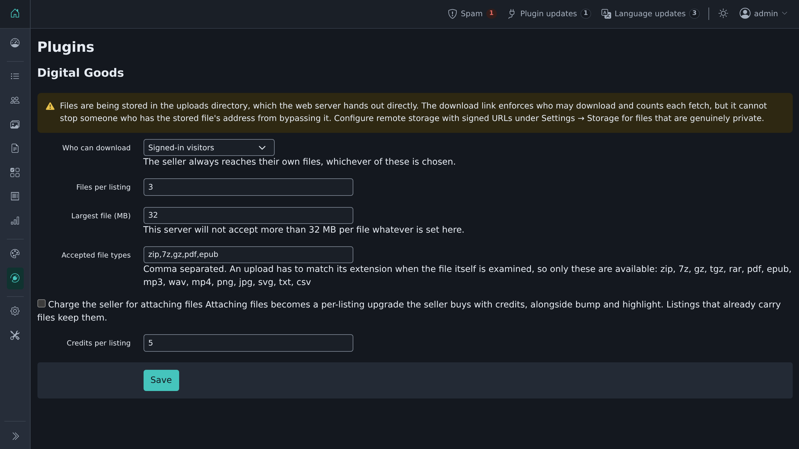

# Digital Goods

Lets a seller attach downloadable files to a listing (a manual, an ebook, a sample pack). Buyers get them through a download link that checks who may have them.



## Requirements

- Shopclass 6.4.0 or later, tested up to 7.0
- PHP 8.0 or later, with the `fileinfo` extension (on by default)
- Optional: S3 storage, set up in core under Settings → Storage

## Install

1. Open Plugins → Browse (or upload the zip from the GitHub release).
2. Install.
3. Activate.

Or run `php oc-cli.php market:install digital-goods`.

## Set up

1. Open Billing → Digital Goods (Plugins → Digital Goods on cores before 7.1).
2. Under **Categories**, pick the categories that take files.
3. Under **Files**, set **Who can download**, **Files per listing** (1 to 20), **Largest file (MB)** and **File types**.
4. Optional, under **Charging**: tick **Charge sellers to attach files** and set **Credits per listing**. It is off by default.
5. Save. Files now appear on the post and edit forms and on the listing page.

Billing → Downloads lists every attached file, its listing and its download count.

## How it works

- Uploads are stored under a random key. Nothing about where a file is kept comes from the uploader. The download address is a separate random token.
- Every download goes through the download link, which applies the access rule and counts the fetch.
- **Who can download** has four choices:
  - **Signed-in visitors** (default)
  - **Anyone**
  - **Anyone who bought it, and the seller**: needs a paid order for the listing (Shopclass 7.0 shop mode). Pending, cancelled and refunded orders do not count.
  - **The seller only**
- The seller can always download their own files.
- Charging: sellers spend credits per listing, like a bump or highlight. Listings that already have files keep them. Only the seller pays. Buyers pay for the listing through the shop.

### Storage

| Storage | Where files go | Delivery |
|---|---|---|
| Local (default) | `oc-content/downloads/digital-goods/`, closed to the web | the link streams the file |
| S3 with signed URLs | the bucket | the link redirects to a signed URL that lasts 5 minutes |
| S3, public bucket | the bucket | the link streams the file |

A public bucket serves a file to anyone who has its address. The link never shows that address, but use signed URLs for private files. The settings screen warns when a public bucket is in use.

### Allowed file types

An upload must match its claimed extension when the file is examined. Only these can be offered: `zip`, `7z`, `gz`, `tgz`, `rar`, `pdf`, `epub`, `mp3`, `wav`, `mp4`, `png`, `jpg`, `svg`, `txt`, `csv`. The default is `zip,7z,gz,pdf,epub`. Anything else typed into **File types** is dropped on save.

The size limit is also capped by what PHP accepts (`upload_max_filesize`).

## Notes / limits

- **nginx:** Apache gets an `.htaccess` that denies the folder. nginx ignores it, so add this to your server block (Shopclass's Docker images already have it):

  ```nginx
  location ^~ /oc-content/downloads/ {
      deny all;
  }
  ```

- **Private folder:** to keep files out of the web root, set this in `config.php` before files are uploaded, or move the `digital-goods` folder there:

  ```php
  define('DG_PRIVATE_PATH', '/var/lib/shopclass-files');
  ```

- **Faster downloads (optional):** PHP streams files in chunks and answers byte ranges. To let the web server send the file instead, use one of these in `config.php`.

  nginx:

  ```nginx
  location ^~ /dg-private/ {
      internal;
      alias /path/to/site/oc-content/downloads/digital-goods/;
  }
  ```

  ```php
  define('DG_ACCEL_REDIRECT', '/dg-private/');
  ```

  Apache with `mod_xsendfile` (`XSendFilePath` set to the folder):

  ```php
  define('DG_XSENDFILE', true);
  ```

- **Upgrading from 2.0.x:** local files lived in `oc-content/uploads/digital-goods/`, which the web server serves. On the first request after the upgrade the plugin moves them to the new folder and closes the old one with an `.htaccess`. Download links do not change. A file that cannot be moved is still served, and the move is retried. On nginx you can also deny the old folder:

  ```nginx
  location ^~ /oc-content/uploads/digital-goods/ {
      deny all;
  }
  ```

- **Stored data:** one table, `t_item_dg_file` (listing, random key, download token, name, size, type, download count). Settings are preferences in the `digital_goods` section.
- **Uninstall** deletes the files, the table and the settings.

## For developers

- Actions: `init`, `item_form`, `item_edit`, `item_detail`, `posted_item`, `edited_item`, `delete_item`, `admin_menu_init`, `api_listings_prefetch`.
- Filters: `api_listing`, `cart_needs_shipping` (a cart of downloads asks for no address), `billing_receipt_details` (adds download links to the paid receipt), `user_menu_filter`.
- On Shopclass 7.0, API listings carry `ext.digital-goods.downloads`: `[{name, url}]` for callers the rule lets in, an empty list for everyone else.

## Support

https://github.com/mindstellar/shopclass-plugin-digital-goods/issues

## License

GPL-3.0-or-later. Derived from the Osclass "Digital Goods" plugin (1.1.0, 2013), originally Apache-2.0. Both notices are kept in the source headers. See CHANGELOG.md for what changed.
